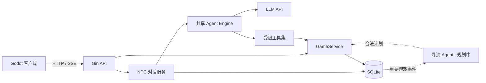

# Ironvale Chronicles

> Agent-Driven Narrative RPG

一款正在开发中的 AI 原生单人叙事 RPG。玩家来到一座依赖铁矿贸易的中世纪小镇，通过自由语言与商人、铁匠、守卫和酒馆老板交涉，调查一辆离奇失踪的铁矿货车。

项目的重点不是让大模型“扮演整个世界”，而是让 Agent 成为游戏系统中的受限参与者：NPC Agent 理解玩家表达、维持角色立场并申请合法行动；确定性的 GameService 保存事实、校验规则并执行状态变更；导演 Agent 只在关键事件后规划可验证的后续机会。

## 项目亮点

- **自由语言驱动玩法**：玩家无需从固定选项中选择，可以直接询问、解释、交涉或提出条件。
- **Agent 与规则分层**：模型负责语言理解和开放式决策，任务、证据、位置与奖励始终由游戏服务裁决。
- **角色级上下文隔离**：会话按 `WorldID + PlayerID + NPCID` 隔离，NPC 只获得自己的身份与对话历史。
- **可控的工具调用**：共享 Engine 通过服务端选定的 ToolSet 限制能力，并将不可授权的调用挡在规则边界之外。
- **流式游戏对话**：Gin 提供 SSE 接口，Godot 客户端可以逐段展示 NPC 回复。
- **可恢复的权威状态**：SQLite 持久化世界、玩家、NPC、任务、证据和对话；初始化不会覆盖已有存档。
- **并发与幂等保护**：玩家位置使用版本号做乐观并发控制；对话使用 `request_id` 避免重复模型调用和重复落库。

## 核心玩法

第一版围绕“失踪的铁矿货车”展开：

1. 玩家向商人马丁了解失踪货物并接受调查任务。
2. 玩家在小镇中移动，与不同 NPC 交谈，拼接各自掌握的信息。
3. 玩家前往货车现场进行调查，游戏服务根据任务状态、坐标和楼层校验行为。
4. 找到的证据被写入存档，并在后续对话和任务流程中成为可验证事实。
5. 后续版本将加入证据出示、物品交换、任务提交与导演 Agent 驱动的分支机会。

## 架构设计



### 职责边界

| 模块 | 职责 | 是否拥有最终决定权 |
| --- | --- | --- |
| NPC Agent | 理解玩家表达、生成符合人设的回应、申请角色行动 | 否 |
| 导演 Agent | 在重要事件后组合合法的剧情机会 | 否 |
| Agent Engine | 执行模型—工具循环，控制轮数、超时和工具权限 | 否 |
| GameService | 校验位置、任务、证据、物品和状态版本 | 是 |
| SQLite | 保存可恢复的权威游戏状态与对话记录 | 是 |

这条边界解决了生成式游戏最关键的问题：NPC 可以灵活回应，但不能因为一句台词就凭空创造证据、完成任务或发放奖励。

## 当前进度

| 能力 | 状态 |
| --- | --- |
| 小镇、玩家与 6 名 NPC 的配置化初始化 | ✅ 已完成 |
| 玩家坐标、楼层与版本号持久化 | ✅ 已完成 |
| 共享 Agent Engine 与工具调用循环 | ✅ 已完成 |
| NPC 人设提示词与独立对话历史 | ✅ 已完成 |
| 普通 HTTP 对话与 SSE 流式输出 | ✅ 已完成 |
| 请求幂等、会话串行化与基础限流 | ✅ 已完成 |
| 货车任务接受、现场范围校验与证据入库 | ✅ 已完成 |
| Godot 场景及服务端联调 | 🚧 进行中 |
| 完整任务提交、物品校验与一次性奖励 | ⏳ 待完成 |
| NPC 查询事实、出示证据与受限行动工具 | ⏳ 待完成 |
| 重要事件驱动的导演 Agent | ⏳ 待完成 |
| 长期记忆、成本控制与降级策略 | ⏳ 待完成 |

> 当前仓库主要包含 Go 游戏服务与 Agent 基础设施；Godot 客户端和 Linux 部署环境不在本仓库中。上表以当前代码为准，不把规划中的能力计为已完成。

## 技术栈

- **客户端**：Godot
- **服务端**：Go、Gin
- **Agent**：Anthropic Go SDK、自研模型—工具执行循环
- **存储**：SQLite（权威状态与会话）
- **长期记忆预研**：Qdrant（不承担任务、物品或世界事实判断）
- **通信**：REST、Server-Sent Events

## 快速开始

### 环境要求

- Go `1.26.5`（以 `go.mod` 为准）
- 一个与 Anthropic Messages API 兼容的模型服务

### 1. 配置模型

当前程序直接读取环境变量，不会自动加载 `.env`：

```powershell
$env:API_KEY = "your-api-key"
$env:MODEL = "your-model-name"

# 使用兼容服务时再设置
$env:BASE_URL = "https://your-endpoint.example/v1"
```

### 2. 启动游戏服务

```powershell
go run ./cmd
```

服务默认监听 `http://127.0.0.1:8080`。首次启动会根据 `config/town/town.json` 创建 `data/game.db`；后续启动会保留已有存档。

### 3. 验证核心接口

```powershell
# 查询玩家
Invoke-RestMethod http://127.0.0.1:8080/api/player

# 接受货车调查任务
Invoke-RestMethod `
  -Method Post `
  http://127.0.0.1:8080/api/quests/missing_iron_cart/accept

# 与商人对话
$body = @{
  request_id = [guid]::NewGuid().ToString()
  message = "那辆铁矿货车最后在哪里出现？"
} | ConvertTo-Json

Invoke-RestMethod `
  -Method Post `
  -ContentType "application/json" `
  -Body $body `
  http://127.0.0.1:8080/api/npcs/merchant/chat
```

流式对话端点为：

```text
POST /api/npcs/:npcID/chat/stream
```

它以 SSE `delta` 事件发送增量文本，并以 `done` 事件返回已经持久化的完整结果。

## API 概览

| 方法 | 路径 | 用途 |
| --- | --- | --- |
| `GET` | `/api/player` | 查询当前玩家状态 |
| `PUT` | `/api/player/position` | 保存坐标、楼层和状态版本 |
| `POST` | `/api/npcs/:npcID/chat` | 获取完整 NPC 回复 |
| `POST` | `/api/npcs/:npcID/chat/stream` | 以 SSE 获取流式 NPC 回复 |
| `GET` | `/api/quests/:questID` | 查询任务定义与玩家进度 |
| `POST` | `/api/quests/:questID/accept` | 接受任务 |
| `POST` | `/api/investigation-points/abandoned_cart/inspect` | 调查废弃货车并记录证据 |

当前接口使用固定的开发身份 `town-1 / player-1`，尚未实现生产级账号与鉴权。

## 项目结构

```text
.
├── cmd/                         # 游戏 HTTP 服务入口
├── config/town/                 # 世界、玩家与 NPC 初始配置
├── internal/agent/engine/       # 可复用的模型—工具执行核心
├── internal/game/               # 权威状态、任务、调查与 SQLite 存储
├── internal/handler/            # HTTP 参数校验与响应映射
├── internal/npc/                # NPC 提示词、Agent 与对话服务
├── internal/rouster/            # Gin 路由注册
└── docs/                        # 开发大纲与早期技术方案
```

## 测试

```powershell
go test ./...
go vet ./...
```

Agent Engine 使用假模型覆盖两条关键路径：直接文本回复，以及工具调用后继续生成最终回复。测试不需要真实 API Key。

## 路线图

1. 完成 Godot 流式对话展示和异常处理。
2. 补齐固定调查故事的任务、物品、证据、知识范围和奖励闭环。
3. 为 NPC 接入事实查询、行动条件查询和受限行动申请工具。
4. 以重要游戏事件触发导演 Agent，并由 GameService 校验、执行其计划。
5. 加入长期记忆、模型分级、缓存、预算和不可用时的玩法降级。

详细方向见 [`docs/cybertown-development-outline.md`](docs/cybertown-development-outline.md)。早期架构讨论保留在 [`docs/medieval-town-agent-plan.md`](docs/medieval-town-agent-plan.md)，如有冲突，以当前开发大纲和实际代码为准。

## 设计原则

```text
玩家自由表达
→ NPC Agent 理解并提出合法行动
→ GameService 校验、执行并保存真实变化
→ 重要事件触发导演 Agent
→ 导演提出可执行的后续计划
→ GameService 再次校验并落地
→ 玩家在世界中看到变化
```

**模型负责可能性，规则负责真实性。**
